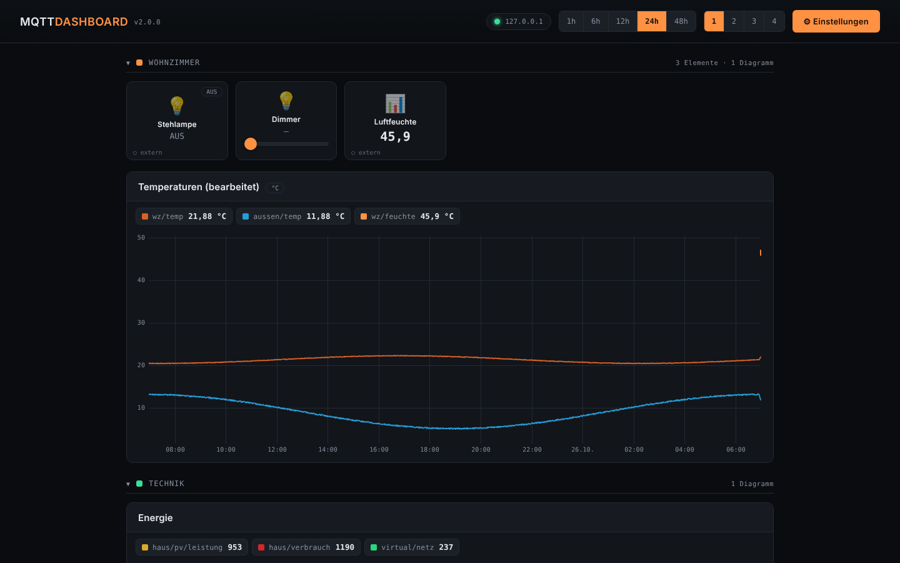
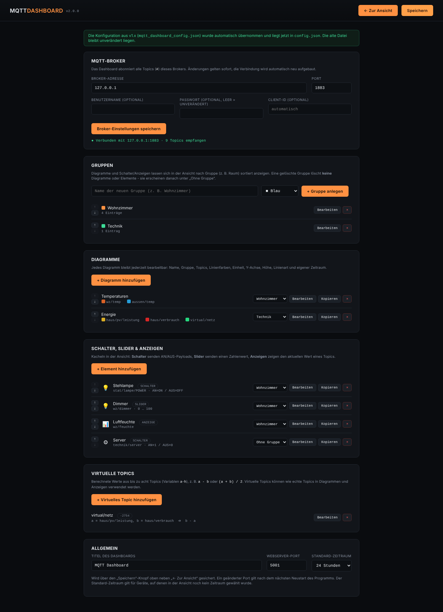

# MQTT Dashboard (MK4) – v2

Lokales Web-Dashboard für MQTT-Topics im eigenen Netzwerk: **Diagramme**,
**Schalter**, **Slider** und **Anzeigen**, frei in **Gruppen** sortierbar,
dazu **virtuelle Topics** (berechnete Werte). Ein Python-Skript
(`app.py`), keine Cloud, kein Account, kein Internet nötig.

Seit **v2.0.0** im Design und mit dem Bedienkonzept des Drucker
Dashboards (MK6), inkl. desselben Build- und Release-Systems per
GitHub Actions.



> Für Architektur, Codestellen und Entscheidungen siehe `UEBERGABE.md`.

---

## Inhalt

- [0. Build & Release per GitHub Actions](#0-build--release-per-github-actions)
- [1. Lokal einrichten/starten](#1-lokal-einrichtenstarten)
- [2. Ansicht & Einstellungen](#2-ansicht--einstellungen)
- [3. Diagramme](#3-diagramme)
- [4. Schalter, Slider & Anzeigen](#4-schalter-slider--anzeigen)
- [5. Virtuelle Topics](#5-virtuelle-topics)
- [6. Konfigurationsdatei & Umstieg von v1.x](#6-konfigurationsdatei--umstieg-von-v1x)
- [7. Grenzen & Hinweise](#7-grenzen--hinweise)

---

## 0. Build & Release per GitHub Actions

`.github/workflows/build-exe.yml` baut bei **jedem Push** auf `main`
automatisch eine Windows-exe und ein macOS-arm64-Binary
(`MQTTDashboard-v<Version>-windows.zip` bzw. `-macos-arm64.zip`) und
veröffentlicht sie als **GitHub Release** (benannt nach `APP_VERSION` in
`app.py`).

**Setup:**
```bash
git init && git add . && git commit -m "Initial commit"
git branch -M main
git remote add origin https://github.com/<user>/<repo>.git
git push -u origin main
```
Danach: Tab **Actions** abwarten (2–4 Min), fertige Zips unter
**Releases**. Kein manueller Tag nötig, kein zusätzliches Secret. Falls
der Release-Schritt mit `403 Resource not accessible by integration`
fehlschlägt: unter **Settings → Actions → General → Workflow
permissions** „Read and write permissions“ aktivieren.

**macOS/Gatekeeper** (Binary ist unsigniert): Finder → Rechtsklick →
„Öffnen“ → „Trotzdem öffnen“, oder `xattr -dr com.apple.quarantine MQTTDashboard`.

**Versionierung:** `APP_VERSION` in `app.py` (`MAJOR.MINOR.PATCH`) ist
die einzige Quelle der Wahrheit – PATCH = Bugfix, MINOR = neues Feature,
MAJOR = Breaking Change. Anpassen und pushen, der Rest läuft automatisch.

## 1. Lokal einrichten/starten

Benötigt **Python 3.8 oder neuer**.

```bash
python -m venv venv && venv\Scripts\activate   # Windows
pip install -r requirements.txt                # flask, paho-mqtt, pyinstaller
python app.py                                  # -> http://<IP-des-PCs>:5001
```

Beim ersten Start öffnet sich automatisch der Einstellungsbereich – dort
den MQTT-Broker eintragen. `config.json` entsteht automatisch neben
`app.py` bzw. neben der exe.

**Eigene exe bauen (optional, sonst siehe Abschnitt 0):**
```bash
pyinstaller --onefile --name MQTTDashboard --console app.py
```

paho-mqtt **1.6.x und 2.x** werden beide unterstützt.

**GL.iNet Brume 2:** Zip per `scp -O` nach `/tmp` kopieren, entpacken,
`sh MQTT-Dashboard-MK4/install.sh` – alles Weitere (Python, Autostart,
Firewall, Übernahme der v1.x-Konfiguration) erledigt der Installer.
Details: **`INSTALL-BRUME2.md`**. Sonstiges Linux: `LINUX-INSTALL.md`.
Der Ordner `vendor/` enthält Flask und paho-mqtt als reine
Python-Pakete (für Python 3.9+), damit dort kein `pip` nötig ist.

## 2. Ansicht & Einstellungen

Wie im Drucker Dashboard gibt es zwei Modi, umschaltbar über
**„⚙ Einstellungen“** oben rechts (bzw. **„← Zur Ansicht“** zurück):

- **Ansicht** (Standard): Diagramme ansehen, Schalter/Slider bedienen,
  Anzeigen ablesen. Oben rechts: Verbindungsstatus, **Zeitraum**
  (1/6/12/24/48 h) und **Diagramm-Spalten** (1/2/3/4). Beide Auswahlen
  merkt sich jeder Browser selbst. Gruppen lassen sich per Klick auf die
  Überschrift auf- und zuklappen. Hinzufügen/Löschen ist hier bewusst
  **nicht** möglich.
- **Einstellungen:** Broker, Gruppen, Diagramme, Schalter/Slider/
  Anzeigen und virtuelle Topics **anlegen, bearbeiten, kopieren,
  sortieren (↑/↓), einer Gruppe zuweisen und entfernen**. Unter
  „Allgemein“ zusätzlich Titel, Webserver-Port und Standard-Zeitraum –
  gesichert über den **„Speichern“**-Knopf in der Kopfzeile.



**Gruppen** sind rein organisatorisch (z. B. Räume). Ohne angelegte
Gruppe erscheint alles als flache Liste; nicht zugewiesene Einträge
stehen unter „Ohne Gruppe“. Eine gelöschte Gruppe löscht **keine**
Diagramme oder Elemente.

Die Ansicht läuft wie v1.9 auch auf alten iPads (iOS 9.3+) und auf dem
iPhone (Kacheln zweispaltig).

## 3. Diagramme

Ein Diagramm kann jederzeit nachträglich bearbeitet werden:

| Einstellung | Bedeutung |
|---|---|
| Name, Gruppe | Überschrift und Gruppe in der Ansicht |
| Topics & Linienfarben | bis zu 12 Topics, je mit optionaler Bezeichnung und frei wählbarer Farbe |
| Einheit | erscheint in Legende und Tooltip |
| Y-Minimum / Y-Maximum | feste Achse, leer = automatisch |
| Höhe | Klein / Mittel / Groß |
| Linienart | Linie oder **Stufen** (ideal für Schaltzustände 0/1) |
| Zeitraum | wie Ansicht, oder fest 1/6/12/24/48 h für dieses Diagramm |
| Fläche füllen | halbtransparente Fläche unter den Linien |

Im Dialog werden alle empfangenen Zahlen-Topics mit aktuellem Wert
gelistet – antippen fügt sie hinzu (Filterfeld oberhalb). In der Ansicht
zeigt die Legende den aktuellen Wert jedes Topics; Maus oder Finger auf
dem Diagramm zeigt Zeitpunkt und Werte.

Die Diagramme werden vom Dashboard selbst gezeichnet – **kein CDN/
Internet** mehr nötig (v1.9 lud Chart.js und Socket.IO aus dem Netz).

## 4. Schalter, Slider & Anzeigen

| Typ | Funktion | Felder |
|---|---|---|
| **Schalter** | Antippen schaltet zwischen AN und AUS | Payload AN/AUS (z. B. `ON`/`OFF` oder `1`/`0`) |
| **Slider** | sendet einen Zahlenwert | Minimum, Maximum, Schritt |
| **Anzeige** | zeigt den aktuellen Wert | Nachkommastellen, optional „Wert für aktiv“ (färbt die Kachel) |

Für alle: Bezeichnung, Symbol (Lampe, Steckdose, Heizung, Waschmaschine,
Solaranlage, …), Gruppe, Einheit. Schalter und Slider haben zusätzlich
ein optionales **Befehls-Topic** (z. B. Tasmota: Status
`stat/…/POWER`, Befehl `cmnd/…/POWER`) und die Option **Retain**.

Unten links auf jeder Kachel steht, woher der letzte Wert kam:
`● eigen` (von diesem Dashboard gesendet), `○ extern`, `◆ virtuell`.

## 5. Virtuelle Topics

Berechnen einen Wert aus bis zu acht Topics (Variablen `a`–`h` in der
Reihenfolge der Quell-Topics), z. B. `b - a` oder `(a + b) / 2`. Erlaubt
sind `+ - * / // % **`, Vergleiche, `x if bedingung else y` sowie
`abs min max round pow sqrt log log10 exp floor ceil sin cos tan pi`.
„Testen“ im Dialog rechnet sofort mit den aktuellen Werten. Virtuelle
Topics stehen danach wie normale Topics für Diagramme und Anzeigen zur
Verfügung.

## 6. Konfigurationsdatei & Umstieg von v1.x

Alles liegt menschenlesbar in **`config.json`** neben der exe bzw.
`app.py` (Beispiel: `config.example.json`). Die Datei kann auch von
Hand bearbeitet werden (Programm vorher beenden).

**Umstieg von v1.9:** neue exe in denselben Ordner wie die alte legen
und starten. Ist noch keine `config.json` vorhanden, wird
`mqtt_dashboard_config.json` automatisch übernommen (Broker, Gruppen,
Diagramme samt Linienfarben, Schalter, Slider, Anzeigen, virtuelle
Topics). Die alte Datei bleibt unverändert. Der Port bleibt **5001**.

## 7. Grenzen & Hinweise

- Messwerte werden wie in v1.9 **nur im Arbeitsspeicher** gehalten
  (max. 48 h, max. 1 Punkt/s und 20 000 Punkte je Topic) – nach einem
  Neustart beginnen die Diagramme leer.
- Es wird `#` abonniert, also alle Topics des Brokers.
- Kein TLS zum Broker (wie v1.9).
- Ein geänderter Webserver-Port gilt erst nach einem Neustart.
- Keine Anmeldung am Dashboard – nur im vertrauenswürdigen LAN betreiben.
